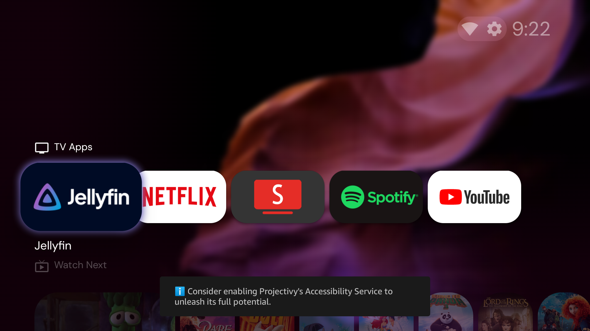

# Fire Stick Clean Setup

Turn a stock Amazon Fire TV Stick into a clean, ad-free, Apple TV-style box:

- **No Amazon ads or sponsored rows**: a custom home screen (Projectivy Launcher) shows only the apps you choose.
- **Home and Back buttons go to your home screen**, not Amazon's.
- **Frosted-glass look**: large rounded app tiles over a blurred scenic wallpaper.
- **Apple TV aerial screensaver** (Aerial Views).
- **Ad-free YouTube** with sponsor skipping (SmartTube).
- **Amazon tracking, promos and junk disabled**, and fully reversible.



Built and tested on a **Fire TV Stick 4K Max (2nd gen, AFTKRT, Fire OS 8 / Android 11)**. Other Fire OS 7/8 sticks should work; packages a model doesn't have are skipped.

> Nothing here roots the device or deletes system files. Every change can be undone (see [Undo](#undo)).

---

## What you need

- A Windows PC on the same Wi-Fi as the Fire Stick
- **ADB** (Android Debug Bridge):
  ```powershell
  winget install --id Google.PlatformTools -e
  ```
  Then open a **new** PowerShell window so `adb` is found.

## 1. Prepare the Fire Stick (on the TV, with the remote)

1. **Settings → My Fire TV → About** → click the device name **7 times** until it says you're a developer.
2. **Settings → My Fire TV → Developer options** → turn on **ADB debugging** (and **Apps from Unknown Sources** if shown).
3. **Settings → My Fire TV → About → Network** → note the **IP address** (e.g. `10.0.0.18`).

## 2. Run the scripts (on the PC)

Open PowerShell in this folder. Allow scripts for this window only:

```powershell
Set-ExecutionPolicy -Scope Process Bypass
```

Replace `10.0.0.18` with your stick's IP. The first time, the TV shows **"Allow USB debugging?"**: tick **Always allow** and choose **OK**.

| Step | Command | What it does |
|---|---|---|
| Preview | `.\scripts\1-debloat.ps1 -Tv 10.0.0.18 -WhatIf` | Shows what would be disabled, changes nothing |
| Debloat | `.\scripts\1-debloat.ps1 -Tv 10.0.0.18` | Disables Amazon tracking, ads, promos and unused extras |
| Apps | `.\scripts\2-install-apps.ps1 -Tv 10.0.0.18` | Installs SmartTube, Projectivy Launcher and Aerial Views from their official GitHub releases, verifying each SHA-256 checksum |
| Home button | `.\scripts\3-enable-home-button.ps1 -Tv 10.0.0.18` | Makes Home and Back go to Projectivy (see note below) |
| Screensaver | `.\scripts\4-set-screensaver.ps1 -Tv 10.0.0.18` | Makes Aerial Views the screensaver |

**About the Home button script:** Fire OS doesn't let you change the default home screen, and it hides third-party accessibility services from its menu. Projectivy works around this with an accessibility service that sees Amazon's home screen open and swaps itself in. That covers both the Home button and backing out of an app. The script switches that service on with adb. It gives Projectivy control over remote button presses, so only run it if you're happy with that.

## 3. Set up the look (on the TV, about 5 minutes)

Open **Projectivy** and press the **Menu (☰)** button on the remote.

**Show only your apps**
1. **Edit categories → Mobile Apps → Visible: off**
2. **Edit categories → TV Apps → Manage apps** → turn off everything except the apps you want (e.g. Jellyfin, Netflix, SmartTube, Spotify, YouTube).

**Apple TV-style glass look:** go to **Projectivy settings → Appearance**.
1. **Cards → Rounded corners:** move the slider **3 steps right**.
2. **Cards → Cards size:** **120%**.
3. **Wallpaper → Launcher wallpaper:** **Reddit** (free rotating scenic photos). Your own image or video needs Projectivy Premium.
4. **Wallpaper → Picture adjustment → Blur:** **6**. This gives the frosted-glass background.

Projectivy can also **export/import** these settings (**Projectivy settings → Manage settings**). "Save locally" keeps the file inside Projectivy, so to copy it to another stick use **Share with another app** with a file-sharing app such as LocalSend.

**Optional, in each app:**
- **SmartTube:** sign in via the person icon (code at `yt.be/activate`), then **Settings → SponsorBlock → on**.
- **Fire TV Settings → Preferences → Featured Content:** turn off video/audio autoplay.
- **Fire TV Settings → Preferences → Privacy Settings:** turn off Device Usage Data, Collect App Usage Data, Interest-based Ads.

---

## What gets disabled

See [`config.ps1`](config.ps1) for the exact list. In groups:

- **Tracking & ads:** telemetry emitter, wireless metrics, performance collection, DP logger, advertising ID (`hybridadidservice`), on-screen content recognition (`tv.acr`), autoplay previews (`sneakpeek`), recommendations
- **Nags & tutorials:** upgrade prompts, release notes, early access, tutorials
- **Shopping:** Amazon Live Shopping
- **Amazon extras:** Photos, Music, miniTV, Luna (`gamehub`, `firebat`, `spiderpork`), Kids (`tahoe`), Silk browser (`cloud9`), Ambient screensaver, smart-home map
- **Live TV & Matter:** Live tab, Matter smart-home hosting

**Never touched:** the Amazon home screen itself, Settings, Appstore, Alexa/voice remote, Bluetooth, push messaging.

### Things learned the hard way

- **Disable, don't uninstall.** `pm uninstall --user 0` looks like it works, but Fire OS quietly reinstalls those apps later. `pm disable-user` survives.
- **Four tracking apps can't be disabled** (`device.metrics`, `device.logmanager`, `device.crashmanager`, `ftvads.deeplinking`): Amazon marks them protected. Blocking their servers with a DNS blocker is the only option. [`extras/adguard-firetv-rules.txt`](extras/adguard-firetv-rules.txt) is a ready-made AdGuard rule list. Servers seen in testing: `unagi-na.amazon.com`, `telemetry.insights.video.a2z.com`, `minerva.devices.a2z.com`, `det-ta-g7g.amazon.com`, `firs-ta-g7g.amazon.com`, `dcape-na.amazon.com`.
- **DNS ad blockers can't stop YouTube ads.** YouTube serves ads from the same servers as the videos, so SmartTube is the fix.
- **adb can't read very long file paths**, so the install script downloads into a short temp folder.
- **A big Fire OS update** can switch the Home button override off or re-enable apps. Just rerun scripts 1 and 3.

## Undo

```powershell
.\scripts\restore.ps1 -Tv 10.0.0.18                  # re-enable every disabled Amazon app
.\scripts\3-enable-home-button.ps1 -Tv 10.0.0.18 -Off # Home goes back to Amazon
.\scripts\4-set-screensaver.ps1 -Tv 10.0.0.18 -Off    # Amazon screensaver
```

Uninstall an app: `adb -s 10.0.0.18:5555 uninstall org.smarttube.stable` (or `com.spocky.projengmenu`, `com.neilturner.aerialviews`).

## Credits

[SmartTube](https://github.com/yuliskov/SmartTube) · [Projectivy Launcher](https://github.com/spocky/miproja1) · [Aerial Views](https://github.com/theothernt/AerialViews). This kit only automates installing and configuring them.

SmartTube blocks YouTube ads, which is against YouTube's terms of service. Use at your own discretion.
